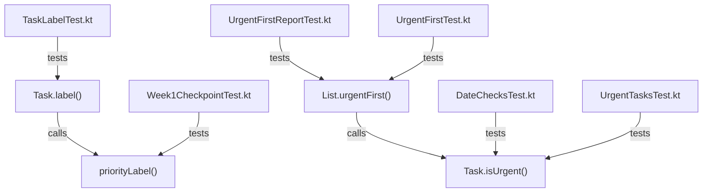

# Urgent-task code map

## Mermaid diagram

## Arrow evidence

| Arrow | File:line | Evidence |
|---|---|---|
| `Task.label()` → `priorityLabel()` | `Task.kt:22` | `Task.label()` calls `priorityLabel(daysLeft)` |
| `urgentFirst()` → `isUrgent()` | `Task.kt:50` | `urgentFirst()` calls `it.isUrgent(today)` |
| `DateChecksTest.kt` → `isUrgent()` | `DateChecksTest.kt:15, 20` | Tests invoke `isUrgent()` |
| `TaskLabelTest.kt` → `label()` | `TaskLabelTest.kt:14, 20, 26, 32, 38, 44, 50, 56` | Tests invoke `label()` |
| `UrgentFirstReportTest.kt` → `urgentFirst()` | `UrgentFirstReportTest.kt:16` | Test invokes `urgentFirst()` |
| `UrgentFirstTest.kt` → `urgentFirst()` | `UrgentFirstTest.kt:33, 64` | Tests invoke `urgentFirst()` |
| `UrgentTasksTest.kt` → `isUrgent()` | `UrgentTasksTest.kt:20–22, 27, 32, 38, 42, 48, 54, 60, 66` | Tests invoke `isUrgent()` |
| `Week1CheckpointTest.kt` → `priorityLabel()` | `Week1CheckpointTest.kt:26–31` | Tests invoke `priorityLabel()` |
