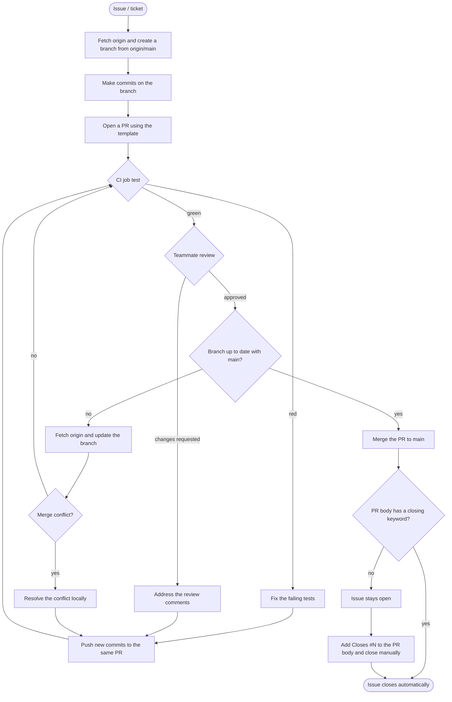

# Ticket-to-main flow

This diagram shows how a ticket becomes a commit on `main` in this repository, including the failure paths that send work back to an earlier step.

## Where each rule lives

| Step or failure path | Source                                                                                                                                                              |
| --- |---------------------------------------------------------------------------------------------------------------------------------------------------------------------|
| Issue / ticket | GitHub Issues UI.                                                                                                                                                   |
| Branch from newest `main` | `AGENTS.md`, lesson 6: run `git fetch origin`, then branch from `origin/main`.                                                                                      |
| Commits on the branch | `AGENTS.md`, lesson 4: the commit message says what the commit does. `README.md`, team rule 2: run all tests before pushing.                                        |
| PR template | `.github/pull_request_template.md`.                                                                                                                                 |
| CI job `test` | `.github/workflows/ci.yml`: runs `./gradlew cleanTest test` on pull requests to `main`.                                                                             |
| Red `test` | `.github/workflows/ci.yml`. Whether `test` is a required check is controlled by branch protection of `main` — not verified.                                         |
| Teammate review | `README.md`, team rule 3: a teammate reviews every PR before it is merged.                                                                                          |
| Review asks for changes | GitHub review UI; the review requirement is in `README.md`, team rule 3.                                                                                            |
| Branch out-of-date | `AGENTS.md`, lesson 6 prevents starting from stale `main`. Whether an up-to-date branch is required is branch protection of `main` — not verified.                  |
| Merge conflict | Git/GitHub merge UI; there is no repo rule file for conflict resolution.                                                                                            |
| Merge to `main` | Branch protection of `main`. Merges can only be done by Terence or by us collaborators with permission. `README.md`, team rule 1 says never change `main` directly. |
| Issue closes | `AGENTS.md`, lesson 1: put `Closes #N` in the PR body.                                                                                                              |
| Missing closing keyword | `AGENTS.md`, lesson 1; the issue stays open until the PR body is corrected or the issue is closed manually.                                                         |