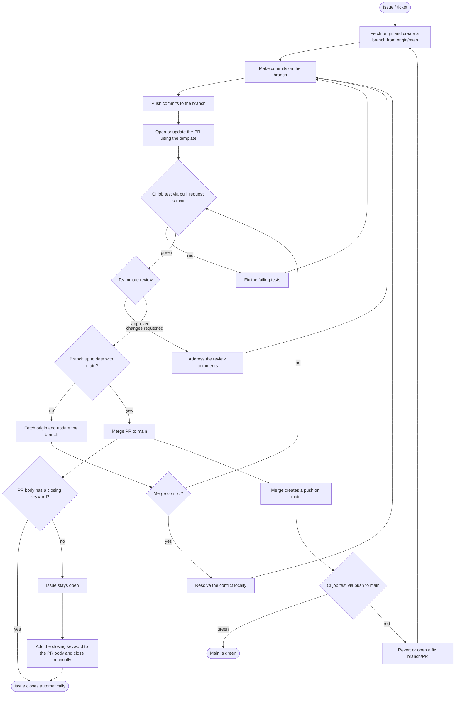

# Ticket-to-main flow

This diagram shows how a ticket becomes a commit on `main` in this repository, including the failure paths that send work back to an earlier step.

> In `.github/workflows/ci.yml`, `pull_request` triggers the job for PRs targeting `main`, and `push` triggers it for commits pushed to `main`. A feature-branch push is tested through the `pull_request` event while the PR is open. The issue closes when the PR merges with a closing keyword in the body; the post-merge `push` test can still fail afterwards.

## Where each rule lives

| Step or failure path | Source |
| --- | --- |
| Issue / ticket | seen in the GitHub UI. |
| Branch from newest `main` | `AGENTS.md`, lesson 6: run `git fetch origin`, then branch from `origin/main`. |
| Commits on the branch | `AGENTS.md`, lesson 4: the commit message says what the commit does. |
| Push commits | `AGENTS.md`, lesson 1 points to `README.md`; `README.md`, team rule 2: run all tests before pushing. |
| PR template | `.github/pull_request_template.md`. |
| CI before merge | `.github/workflows/ci.yml`: `pull_request` trigger on PRs to `main`; job `test` runs `./gradlew cleanTest test`. |
| Red CI before merge | `.github/workflows/ci.yml`; fix the tests and push new commits to the same PR. |
| Teammate review | `AGENTS.md`, lesson 1 points to `README.md`; `README.md`, team rule 3: a teammate reviews every PR. |
| Review asks for changes | seen in the GitHub UI; the review requirement is in `README.md`, team rule 3. |
| Branch out-of-date | `AGENTS.md`, lesson 6 prevents starting from stale `main`. Whether an up-to-date branch is required is branch protection of `main` — not verified. |
| Fetch and update the branch | seen in the GitHub UI. |
| Merge conflict | seen in the GitHub UI; no repo rule file. |
| Resolve conflict locally | seen in the GitHub UI; no repo rule file. |
| Merge to `main` | `AGENTS.md`, lesson 1 points to `README.md`; `README.md`, team rule 1: never change `main` directly. Branch protection of `main` — not verified. |
| PR body has a closing keyword | `AGENTS.md`, lesson 1: put `Closes #N` in the PR body. This happens at merge, not after the post-merge CI run. |
| Issue closes automatically | `AGENTS.md`, lesson 1. |
| Issue stays open | `AGENTS.md`, lesson 1; the issue stays open until the closing keyword is added or someone closes it manually. |
| Add closing keyword and close manually | `AGENTS.md`, lesson 1; seen in the GitHub UI. |
| Merge creates a push on `main` | seen in the GitHub UI; `push` trigger is in `.github/workflows/ci.yml`. |
| CI after merge | `.github/workflows/ci.yml`: `push` trigger on `branches: [ main ]`; job `test` runs `./gradlew cleanTest test`. |
| Main is green | `.github/workflows/ci.yml`, job `test`. |
| Red CI after merge | seen in the GitHub UI; revert or open a fix branch/PR. Whether this is enforced as a merge gate is branch protection of `main` — not verified. |
